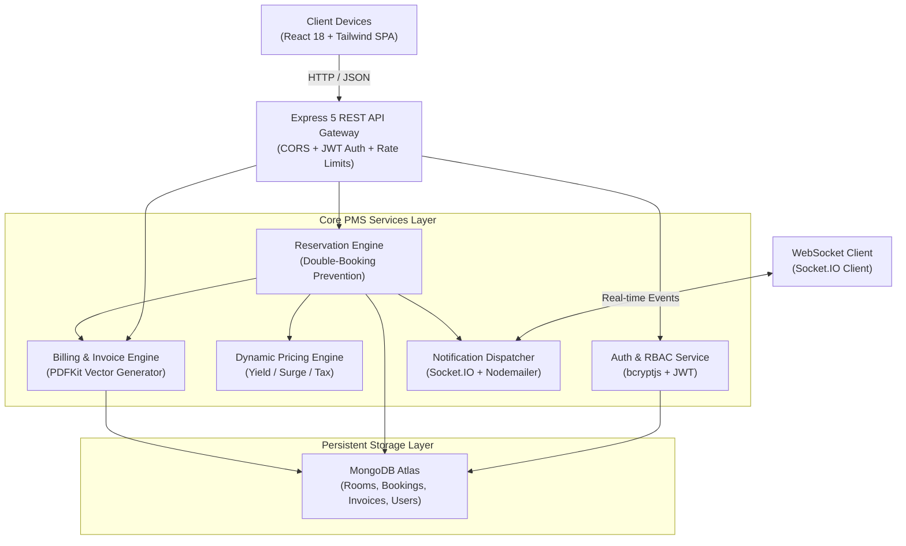

<div align="center">

# 🏨 Luxe Haven | Cloud-Based Hotel Property Management System (PMS)

### *Enterprise-Grade Hotel PMS & Hospitality Intelligence Platform*

[](https://nodejs.org/)
[](https://reactjs.org/)
[](https://tailwindcss.com/)
[](https://www.mongodb.com/atlas)
[](https://fullcalendar.io/)
[](https://recharts.org/)
[](https://pdfkit.org/)
[](https://socket.io/)
[](https://www.docker.com/)

<br/>


<br/>

**[Explore Live Demo](http://localhost:5000)** • **[Quick Setup](#-quick-start--setup)** • **[RBAC Accounts](#-role-based-access-control-rbac--demo-accounts)** • **[API Docs](#-api-endpoints-summary)** • **[Docker Deployment](#-docker-deployment)**

---

</div>

## 📖 Overview

**Luxe Haven** is a state-of-the-art, full-stack **Cloud-Based Hotel Property Management System (PMS)** engineered for boutique hotels, luxury resorts, and multi-room hospitality properties. Built on modern web standards with **React 18**, **Tailwind CSS**, **Node.js**, **Express.js**, and **MongoDB Atlas**, Luxe Haven delivers real-time room availability, concurrency-safe double-booking prevention, automated GST billing with PDFKit, FullCalendar scheduling, live Socket.IO alerts, and executive Recharts analytics.

---

## 🌟 The Final 5 Major Upgrades

```
┌─────────────────────────────────────────────────────────────────────────────┐
│                       LUXE HAVEN HOTEL PMS SUITE                            │
├─────────────────────────────────────────────────────────────────────────────┤
│  01. Smart Room & Reservation Engine (Availability, Double-Booking, Keys)   │
│  02. Multi-Tier RBAC & Auth Security (Admin, Manager, Reception, Customer)  │
│  03. Automated Billing & Sequential GST Invoices (PDFKit Vector Engine)     │
│  04. Interactive FullCalendar & Socket.IO Notification Center               │
│  05. Visual Executive Analytics Dashboard (Recharts Live Intelligence)      │
└─────────────────────────────────────────────────────────────────────────────┘
```

---

### 01 · Critical: Smart Room & Reservation Management Engine

<div align="center">
  
</div>

- **Real-Time Room Availability**: Dynamic availability queries calculate vacancy based on check-in and check-out dates across room categories (*Standard, Deluxe, Executive Suite, Presidential Suite, Ocean Villa*).
- **Double-Booking Prevention Engine**: Concurrency-safe date overlap validation (`checkInDate < reqCheckOutDate && checkOutDate > reqCheckInDate`) guarantees that no room can be double-booked across `confirmed`, `checked_in`, or `pending` states.
- **Front-Desk Key & Check-In Workflow**: Front-desk agents issue physical keys or smart card tags (`KEY-201-A`) upon arrival, track check-in timestamps, and automatically transition room status to `occupied`.
- **Intelligent Housekeeping Lifecycle**: Automatic housekeeping status transitions:
  $$\text{Clean} \xrightarrow{\text{Check-In}} \text{Occupied} \xrightarrow{\text{Check-Out}} \text{Dirty (Service Required)} \xrightarrow{\text{Cleaned}} \text{Inspected} \rightarrow \text{Clean}$$
- **Yield Management & Dynamic Pricing**: Real-time rate adjustments based on:
  - Weekend surcharges (+15% Friday & Saturday night stays).
  - Seasonal multipliers for peak holiday travel.
  - Occupancy surge multipliers (triggers +20% surge when hotel occupancy &ge; 80%).
  - Promo code discounts (`LUXE10`, `WELCOME20`, `VIP50`).

---

### 02 · Role-Based Access Control (RBAC) & Security

Luxe Haven enforces granular role-based permissions across both the React frontend and protected REST APIs via JWT tokens and bcrypt encryption:

| Role | Interface / Dashboard | Permissions & Capabilities |
|:---:|:---|:---|
| <span style="color:#c084fc; font-weight:bold;">Admin</span> | **Executive Dashboard** | Full system control, user & staff management, dynamic role assignment, financial audit logs, system configuration. |
| <span style="color:#38bdf8; font-weight:bold;">Hotel Manager</span> | **Manager Operations** | Room inventory control, dynamic pricing & surcharge multipliers, occupancy oversight, reservations supervision. |
| <span style="color:#34d399; font-weight:bold;">Receptionist</span> | **Front Desk Operations** | Daily arrivals & departures schedule, interactive room rack grid, key card issuance, 1-click housekeeping status updates. |
| <span style="color:#fbbf24; font-weight:bold;">Customer</span> | **Guest Privilege Portal** | Room browsing & date search, instant self-service booking, stay history, active room key viewer, downloadable tax invoices. |

> 💡 **1-Click Demo Role Switcher**: A dedicated switcher bar at the top of the app allows instant 1-click switching between **Admin**, **Hotel Manager**, **Receptionist**, and **Customer** to test every dashboard without logging out!

---

### 03 · Automated Billing & Sequential Invoice Management

<div align="center">
  
</div>

- **Automatic Cost Calculation**: Itemized billing accounts for room nights, dynamic adjustments, promo discounts, and luxury add-ons (*Airport Limousine, Gourmet Breakfast, Champagne & Caviar, Spa Passes*).
- **Sequential Invoice Numbering**: Automated, consecutive invoice numbering adhering to global financial compliance (`INV-2026-0001`, `INV-2026-0002`).
- **GST / Tax Compliance Breakdown**: Automated 18% GST calculation split into **9% CGST** and **9% SGST** with taxable subtotal calculation.
- **Downloadable Vector PDF Invoices (PDFKit)**: Streams professional, printable PDF invoices directly to the browser with:
  - Official Luxe Haven Hotel PMS branding and contact header.
  - Sequential Invoice Number, Issue Date, and Due Date.
  - Guest contact information and reservation summary.
  - Bordered itemized line-items table.
  - Tax breakdown (CGST, SGST, Total Tax).
  - High-visibility status stamp (**PAID IN FULL** in emerald green / **PAYMENT PENDING** in amber).
  - Terms & conditions and electronic signature notice.

---

### 04 · Interactive Booking Calendar & Real-Time Notification System

<div align="center">
  
</div>

- **Interactive FullCalendar Suite**: Powered by `@fullcalendar/react` with smooth view toggles:
  - **Month Grid View** (`dayGridMonth`)
  - **Weekly Schedule** (`timeGridWeek`)
  - **Daily Schedule** (`timeGridDay`)
- **Color-Coded Reservation States**:
  - 🟢 **Confirmed**: `#10b981` (Emerald Green)
  - 🔵 **Checked-In**: `#0284c7` (Sky Blue)
  - ⚪ **Checked-Out**: `#64748b` (Slate Gray)
  - 🟡 **Pending**: `#f59e0b` (Amber)
  - 🔴 **Cancelled**: `#ef4444` (Rose Red)
- **Interactive Event Details Modal**: Click any reservation bar to inspect guest details, stay dates, billed totals, and trigger quick front-desk actions (Check-In / Check-Out).
- **Socket.IO Real-Time Alerts**: WebSocket event broadcasting triggers live animated toast alerts in the bottom-right corner whenever a booking is created, checked in, or paid.
- **Automated Email Delivery (Nodemailer)**: Sends beautifully formatted HTML receipts and booking confirmation notices directly to guests.

---

### 05 · Visual Differentiator: Interactive Admin Dashboard & Analytics

<div align="center">
  
</div>

- **Executive KPI Cards**:
  - **Gross Revenue**: Total collected from settled invoices.
  - **Occupancy Rate %**: Real-time ratio of occupied rooms vs total inventory.
  - **Total Bookings**: Reservation volume in selected time window.
  - **Available Rooms**: Vacant inventory ready for booking.
  - **RevPAR (Revenue Per Available Room)**: Vital hotel performance metric.
  - **Pending Revenue**: Unsettled balances awaiting payment.
- **Interactive Recharts Visualizations**:
  - **Monthly Revenue Area Chart**: Smooth dual-tone area chart showing gross income trends over time.
  - **Booking Status Donut Chart**: Proportional slice breakdown of reservation statuses.
  - **Room Category Rates Bar Chart**: Inventory volume and average nightly rate comparison.
- **Date-Range Filtering**: Switch analytics between `Today`, `Last 7 Days`, `Last 30 Days`, `This Month`, `Year to Date`, and `All Time`.
- **Front-Desk Live Activity Audit Feed**: Real-time log tracking front-desk actions, key assignments, and staff operations.

---

## 🏗️ System Architecture



---

## 🔑 Role-Based Access Control (RBAC) & Demo Accounts

All demo accounts are pre-seeded in the database and accessible via the **1-Click Demo Switcher** in the top navigation bar:

| Role | Username | Demo Email | Password | Assigned Dashboard |
|:---|:---|:---|:---|:---|
| **Admin** | `admin` | `admin@luxehaven.com` | `Password@123` | Executive Analytics & User Management |
| **Hotel Manager** | `manager` | `manager@luxehaven.com` | `Password@123` | Dynamic Pricing & Yield Operations |
| **Receptionist** | `reception` | `reception@luxehaven.com` | `Password@123` | Front Desk Rack & Key Cards |
| **Customer** | `guest` | `guest@luxehaven.com` | `Password@123` | Guest Portal & Invoices |

---

## ⚡ Quick Start & Setup

### Prerequisites
- [Node.js](https://nodejs.org/) (v20+ or v22+ recommended)
- [Git](https://git-scm.com/)
- [npm](https://www.npmjs.com/) (v10+)

### 1. Clone the Repository
```bash
git clone https://github.com/ziuskumar/Luxe_Haven.git
cd Luxe_Haven
```

### 2. Install Dependencies
```bash
# Install backend dependencies
cd backend && npm install
cd ..

# Install frontend dependencies
cd frontend && npm install
cd ..
```

### 3. Seed Database
Populate MongoDB Atlas with default luxury rooms, staff roles, and initial reservations:
```bash
npm run seed
```

### 4. Build & Launch Unified Application
```bash
# Build the React + Tailwind production bundle
npm run build

# Start the unified server (Express + React + Socket.IO)
npm start
```
The PMS application is now live at: **[http://localhost:5000](http://localhost:5000)**

---

## 🧪 Testing Suite

### Unit & Engine Tests (Jest + Supertest)
Runs automated tests verifying dynamic pricing, weekend surcharges, double-booking prevention, JWT signing/verification, and sequential invoice generation:
```bash
npm test
```

### End-to-End Tests (Playwright)
```bash
npx playwright test
```

---

## 🐳 Docker Deployment

The application includes a multi-stage Docker build that compiles the React frontend and runs the Node.js Express server in a single production-optimized container.

```bash
# Build and run with Docker Compose
docker-compose up --build -d

# View container logs
docker-compose logs -f
```
Access the containerized PMS at **http://localhost:5000**.

---

## 📡 API Endpoints Summary

### Authentication & Users
- `POST /api/auth/register` - Register customer account
- `POST /api/auth/login` - Authenticate and return JWT token
- `GET /api/auth/me` - Get profile of authenticated user
- `GET /api/auth/users` - List all staff & users *(Admin only)*
- `PUT /api/auth/users/:id` - Update user role / status *(Admin only)*

### Rooms & Availability
- `GET /api/rooms` - Query rooms with date-availability & category filters
- `GET /api/rooms/:id` - Get room details
- `POST /api/rooms` - Create new room *(Admin / Manager)*
- `PUT /api/rooms/:id` - Update room details & dynamic pricing *(Admin / Manager)*
- `PATCH /api/rooms/:id/housekeeping` - Update housekeeping status *(Staff only)*

### Bookings & Reservation Engine
- `GET /api/bookings/check-availability` - Real-time availability check
- `POST /api/bookings/calculate-price` - Dynamic price preview calculation
- `POST /api/bookings` - Create booking with double-booking prevention
- `GET /api/bookings` - List bookings (filtered by role)
- `POST /api/bookings/:id/check-in` - Check in guest & assign room key *(Staff only)*
- `POST /api/bookings/:id/check-out` - Check out guest & flag room dirty *(Staff only)*
- `POST /api/bookings/:id/cancel` - Cancel reservation

### Billing & Invoices
- `GET /api/invoices` - List sequential invoices
- `GET /api/invoices/:id` - Get single invoice details
- `GET /api/invoices/:id/download` - Stream PDFKit generated vector invoice PDF
- `POST /api/invoices/:id/payment` - Settle payment balance

### Calendar & Analytics
- `GET /api/calendar/events` - FullCalendar formatted events feed
- `GET /api/calendar/daily` - Today's arrivals, departures, and in-house schedule
- `GET /api/analytics` - Executive analytics, Recharts datasets, and KPIs *(Admin / Manager)*
- `GET /api/notifications` - Real-time in-app notification center

---

## 📁 Project Directory Structure

```
├── backend/
│   ├── controllers/         # REST API Controllers (Auth, Rooms, Bookings, Invoices, Calendar, Analytics)
│   ├── middleware/          # Auth & RBAC Middleware (protect, restrictTo)
│   ├── Models/              # Mongoose Schemas (User, Room, Booking, Invoice, Notification, AuditLog)
│   ├── Route/               # Express API Router (/api/...)
│   ├── services/            # Core PMS Engines (Pricing, Reservation, Invoice PDFKit, Socket.IO Notifications)
│   ├── tests/               # Jest test suites
│   ├── init/                # Database seeders (seedPMS.js)
│   └── app.js               # Express + Socket.IO entry point
│
├── frontend/
│   ├── src/
│   │   ├── components/      # React components
│   │   │   ├── Dashboards/  # Role-specific dashboards (Admin, Manager, Receptionist, Customer)
│   │   │   ├── Rooms/       # Real-time room availability & Booking modal with pricing preview
│   │   │   ├── Calendar/    # FullCalendar scheduling view with modal details
│   │   │   ├── Invoices/    # Sequential billing table with PDFKit download buttons
│   │   │   └── Users/       # Admin RBAC management
│   │   ├── context/         # AuthContext (JWT & demo switcher) & SocketContext (live alerts)
│   │   ├── App.jsx          # Root component
│   │   └── main.jsx         # React DOM entry
│   └── dist/                # Production React bundle
│
├── Dockerfile               # Multi-stage production container build
├── docker-compose.yml       # Production container orchestration
├── package.json             # Root monorepo scripts
└── README.md                # System documentation
```

---

## 📜 License & Credits

Distributed under the MIT License. Developed with ❤️ for **Luxe Haven Cloud PMS** by [ziuskumar](https://github.com/ziuskumar).
