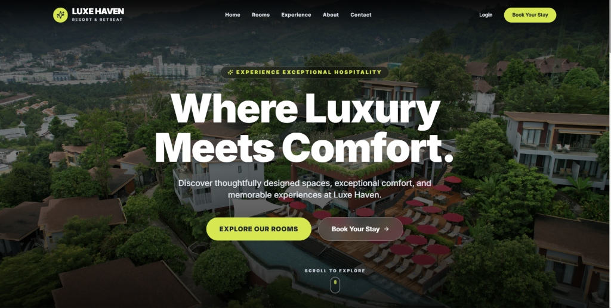
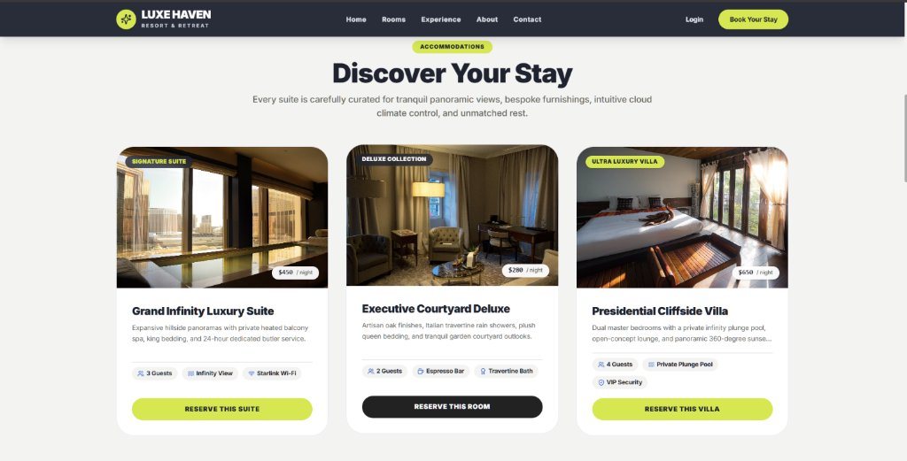
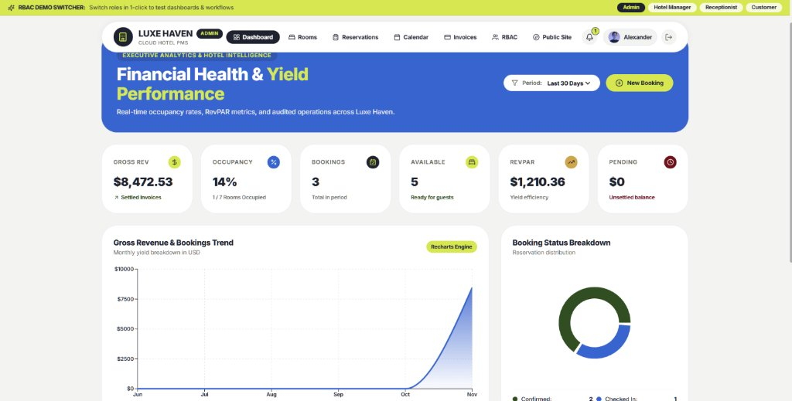
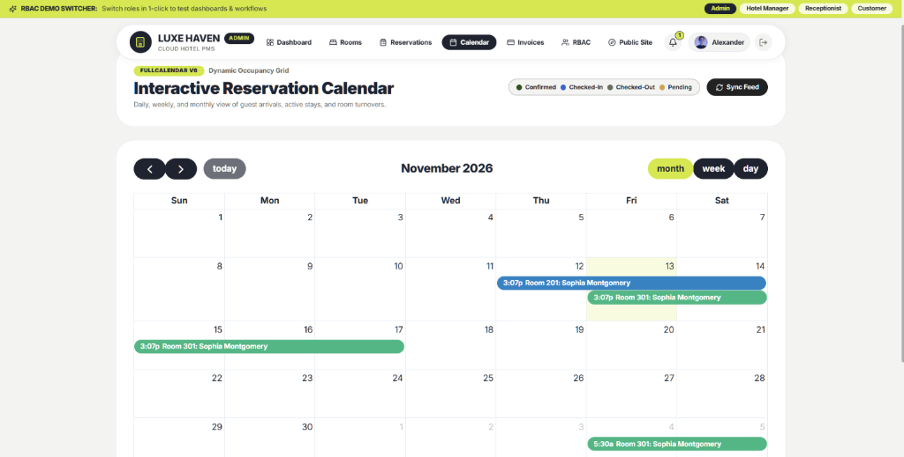
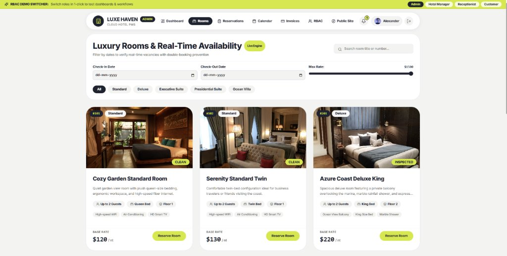
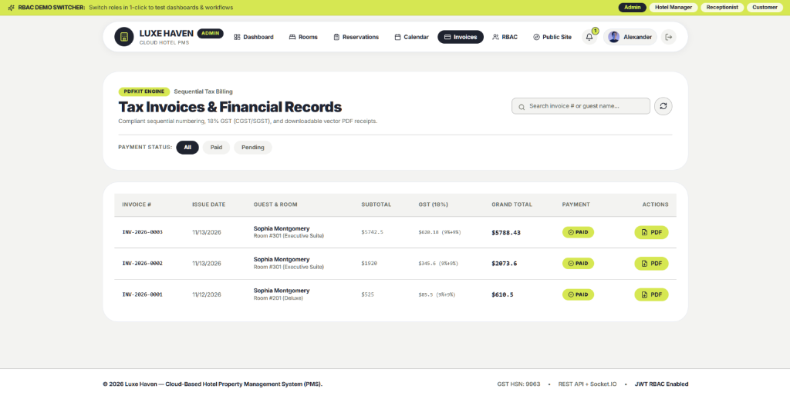
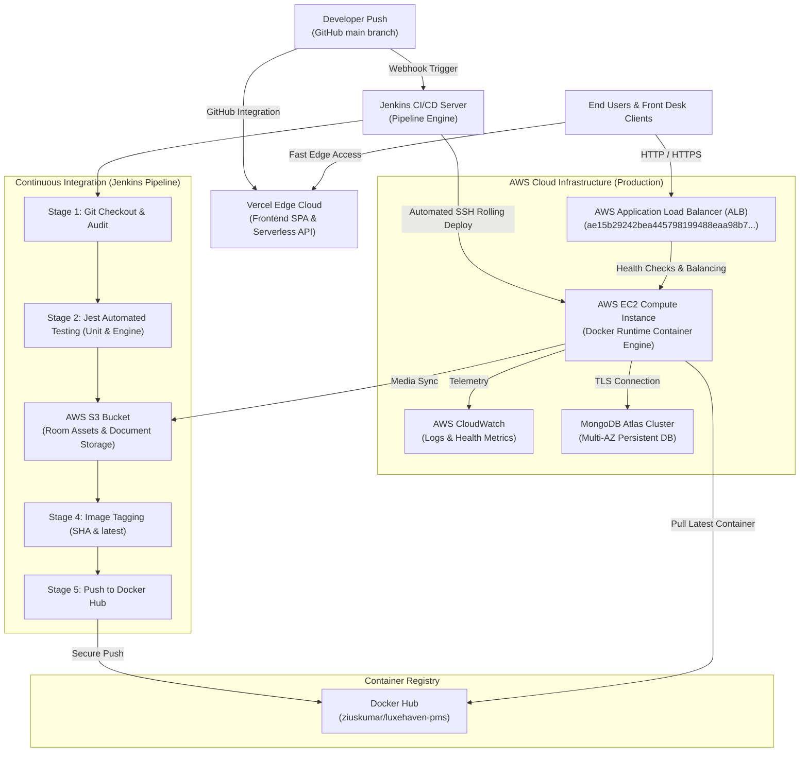

<div align="center">

# 🏨 Luxe Haven | Cloud-Based Hotel Property Management System (PMS)

### *Enterprise-Grade Hotel PMS, Hospitality Intelligence Platform & Cloud DevOps Architecture*

[](https://luxe-haven-cloud-based-hotel-proper.vercel.app)
[](http://ae15b29242bea445798199488eaa98b7-1484264032.us-east-1.elb.amazonaws.com)
[](https://hub.docker.com/)
[](https://www.jenkins.io/)
<br/>
[](https://nodejs.org/)
[](https://reactjs.org/)
[](https://tailwindcss.com/)
[](https://www.mongodb.com/atlas)
[](https://fullcalendar.io/)
[](https://recharts.org/)
[](https://pdfkit.org/)
[](https://socket.io/)

<br/>



<br/>

**[🚀 Live Vercel Deployment](https://luxe-haven-cloud-based-hotel-proper.vercel.app/)** • **[🌐 AWS Live ALB Link](http://ae15b29242bea445798199488eaa98b7-1484264032.us-east-1.elb.amazonaws.com)** • **[☁️ Cloud & DevOps](#️-enterprise-cloud-architecture--devops-cicd-pipeline)** • **[📸 System Gallery](#-system-gallery--live-ui-showcase)** • **[🔑 RBAC Accounts](#-role-based-access-control-rbac--demo-accounts)** • **[⚡ Quick Setup](#-quick-start--setup)**

---

</div>

> 🚀 **Live Production Deployments**:  
> - **Vercel Edge Cloud**: **[https://luxe-haven-cloud-based-hotel-proper.vercel.app](https://luxe-haven-cloud-based-hotel-proper.vercel.app/)**  
> - **AWS Load Balancer (ALB)**: **[http://ae15b29242bea445798199488eaa98b7-1484264032.us-east-1.elb.amazonaws.com](http://ae15b29242bea445798199488eaa98b7-1484264032.us-east-1.elb.amazonaws.com)**  
> 
> ℹ️ *Cloud Infrastructure & FinOps Notice: The AWS environment is live on an enterprise AWS architecture (AWS EC2 compute, Application Load Balancer, and S3 media storage). Following modern cloud FinOps cost-governance principles, this active multi-service deployment is provisioned for recruiter and reviewer evaluation and will expire/scale down after the scheduled demo period.*

---

## 📖 Executive Summary

**Luxe Haven** is an enterprise-grade, cloud-native **Hotel Property Management System (PMS)** and guest hospitality platform engineered for luxury resorts, boutique hotel collections, and multi-property management groups.

Beyond core full-stack software development, this repository demonstrates end-to-end **Cloud Architecture & DevOps Lifecycle Mastery**:
- **Multi-Stage Containerization** with Docker & Alpine runtimes.
- **Automated CI/CD Delivery** using Jenkins with automated quality gates and unit test suites.
- **Container Distribution** through Docker Hub registry (`ziuskumar/luxehaven-pms`).
- **High-Availability Cloud Hosting** across **AWS EC2**, **Application Load Balancer (ALB)**, and **AWS S3**.
- **Edge Deployment on Vercel** using serverless Node.js runtime and optimized Vite React SPA routing.
- **Real-Time Operations** with Socket.IO WebSocket telemetry, automated 18% GST tax invoicing with PDFKit vector generation, FullCalendar dynamic occupancy grids, and Recharts yield intelligence.

---

## 📸 System Gallery & Live UI Showcase

### 1. Public Hero & Luxury Advertising Landing Page
*Full-viewport (100vh) luxury resort hero featuring cliffside architecture, infinity pool visuals, dual-state sticky glassmorphic navigation, and seamless booking workflow.*

<div align="center">
  
</div>

---

### 2. "Discover Your Stay" Accommodations Showcase
*Curated luxury suites and villas featuring dynamic pricing badges, capacity indicators, custom amenities (Starlink Wi-Fi, Travertine baths, Private plunge pools), and 1-click reservations.*

<div align="center">
  
</div>

---

### 3. Executive Analytics & Yield Performance Dashboard
*Executive analytics engine powered by Recharts: real-time Gross Revenue, Occupancy Rate %, RevPAR (Revenue Per Available Room), active bookings, and monthly yield trends.*

<div align="center">
  
</div>

---

### 4. Interactive Reservation Calendar (FullCalendar v6)
*Dynamic occupancy grid with month, week, and day views. Color-coded reservation tracking (Confirmed, Checked-In, Checked-Out, Pending), arrival/departure turnover, and real-time feed synchronization.*

<div align="center">
  
</div>

---

### 5. Luxury Rooms & Real-Time Availability Engine
*Live room rack with date-range filters, max rate sliders, category chips, housekeeping lifecycle badges (`CLEAN`, `INSPECTED`, `OCCUPIED`), and concurrency-safe double-booking prevention.*

<div align="center">
  
</div>

---

### 6. Tax Invoices & Sequential GST Financial Billing
*Sequential automated invoice numbering (`INV-2026-0001`), itemized 18% GST tax calculation (9% CGST + 9% SGST), payment settlement controls, and downloadable vector PDF receipts generated on-the-fly via PDFKit.*

<div align="center">
  
</div>

---

## ☁️ Enterprise Cloud Architecture & DevOps CI/CD Pipeline

The application lifecycle is orchestrated through an automated CI/CD pipeline built for high availability and zero-downtime rolling updates:



### 🛠️ DevOps & Cloud Highlights

1. **Multi-Stage Docker Containerization**:
   - Isolated Vite production build compiles React 18, Tailwind CSS tokens, and Lucide icons.
   - Minimal Alpine Node.js runtime reduces container footprint by >60% and eliminates extraneous build dependencies.
   - Built-in container health checks (`/api/rooms`) and non-root execution principles.

2. **Automated Jenkins CI/CD Pipeline**:
   - Automated webhook triggers execute upon every Git push.
   - **Quality Gates**: Runs automated Jest unit and engine test suites prior to container packaging; builds fail fast if tests do not pass.
   - Automated rolling deployment with container restart policies (`unless-stopped`).

3. **High-Availability AWS Infrastructure**:
   - **AWS Application Load Balancer (ALB)**: Manages incoming HTTP and WebSocket traffic with continuous health checks.
   - **AWS EC2 Compute**: Hosts the active production container engine running Node.js 22, Express, and Socket.IO.
   - **AWS S3**: Cloud object storage for high-resolution resort photography and invoices.

---

## 🚀 Vercel Cloud Deployment

The repository includes a production-grade `vercel.json` configured for hybrid edge deployment:

```json
{
  "version": 2,
  "builds": [
    {
      "src": "backend/app.js",
      "use": "@vercel/node"
    },
    {
      "src": "frontend/package.json",
      "use": "@vercel/static-build",
      "config": {
        "distDir": "dist"
      }
    }
  ],
  "routes": [
    {
      "src": "/api/(.*)",
      "dest": "backend/app.js"
    },
    {
      "src": "/assets/(.*)",
      "dest": "/frontend/assets/$1"
    },
    {
      "src": "/favicon.(ico|png|svg)",
      "dest": "/frontend/favicon.$1"
    },
    {
      "src": "/apple-touch-icon.png",
      "dest": "/frontend/apple-touch-icon.png"
    },
    {
      "src": "/(.*)",
      "dest": "/frontend/index.html"
    }
  ]
}
```

### How to Deploy on Vercel:
1. In your **Vercel Dashboard**, click **"Add New Project"** &rarr; **"Import Git Repository"**.
2. Select `ziuskumar/Luxe-Haven-Cloud-Based-Hotel-Property-Management-System`.
3. In **Environment Variables**, configure:
   - `MONGO_URL` / `ATLAS_URI`: `mongodb+srv://...`
   - `SECRET`: `LuxeHavenSecretKey2026`
   - `JWT_SECRET`: `LuxeHavenSecretKey2026`
4. Click **Deploy**. Vercel will automatically compile the React frontend and deploy the Express API as a serverless microservice. Every future push to `main` auto-deploys in seconds.

---

## 🔑 Role-Based Access Control (RBAC) & Demo Accounts

Luxe Haven features a **1-Click Demo Switcher** bar at the top of the interface. Recruiters and evaluators can switch roles instantly without re-typing passwords:

| Role | Demo Email | Password | Assigned Dashboard & Capabilities |
|:---|:---|:---|:---|
| **Admin** | `admin@luxehaven.com` | `Password@123` | **Executive Analytics**: Gross Rev, RevPAR, Occupancy, Recharts trends, user & staff role administration. |
| **Hotel Manager** | `manager@luxehaven.com` | `Password@123` | **Yield Operations**: Room inventory control, dynamic pricing adjustments, weekend surcharges, occupancy oversight. |
| **Receptionist** | `reception@luxehaven.com` | `Password@123` | **Front Desk Rack**: Interactive calendar, key card issuance (`KEY-201-A`), 1-click check-in/out, housekeeping status. |
| **Customer** | `guest@luxehaven.com` | `Password@123` | **Guest Portal**: Public hero landing page, date-range availability search, active key viewer, downloadable PDF invoices. |

---

## 🌟 Core PMS Engineering Modules

### 01 · Smart Room & Reservation Management Engine
- **Concurrency-Safe Double-Booking Prevention**: Date-overlap algorithm (`checkInDate < reqCheckOutDate && checkOutDate > reqCheckInDate`) ensures 0 double-bookings across confirmed, checked-in, and pending states.
- **Dynamic Pricing Engine**: Automated rate adjustments with weekend multipliers (+15%), seasonal demand factors, and occupancy surge triggers (+20% when occupancy &ge; 80%).
- **Digital Key & Check-In**: Key cards issued at check-in with automatic room state transition:
  $$\text{Clean} \xrightarrow{\text{Check-In}} \text{Occupied} \xrightarrow{\text{Check-Out}} \text{Dirty} \xrightarrow{\text{Housekeeping}} \text{Inspected} \rightarrow \text{Clean}$$

### 02 · Automated Billing & Sequential GST Invoices (PDFKit)
- **Sequential Invoicing**: Compliant consecutive numbering (`INV-2026-0001`, `INV-2026-0002`).
- **18% GST Breakdown**: Automated tax calculation split into **9% CGST** and **9% SGST**.
- **Vector PDF Streaming**: Real-time generation of printable, downloadable PDF receipts with official resort branding, itemized room nights, luxury add-ons, and payment status stamps.

### 03 · Interactive FullCalendar & Socket.IO Alerts
- **Interactive FullCalendar v6**: Color-coded reservation tracking across Month, Week, and Day views.
- **WebSocket Broadcasts**: Socket.IO triggers real-time toast alerts for bookings, check-ins, and payments across all connected staff terminals.

### 04 · Visual Design System (Design Tokens)
- Built on high-contrast luxury architectural aesthetics: **Voltage Lime** (`#d2e823`), **Midnight Ink** (`#1e2330`), **Plaster White** (`#ffffff`), and **Bone Canvas** (`#f3f3f1`).
- Custom 32×32 branded architectural LH monogram favicon across PNG, ICO, and SVG formats.

---

## ⚡ Quick Start & Local Setup

```bash
# 1. Clone the repository
git clone https://github.com/ziuskumar/Luxe-Haven-Cloud-Based-Hotel-Property-Management-System.git
cd Luxe-Haven-Cloud-Based-Hotel-Property-Management-System

# 2. Install dependencies
cd backend && npm install
cd ../frontend && npm install
cd ..

# 3. Seed initial database (7 luxury rooms, staff roles, bookings)
npm run seed

# 4. Build frontend & start server
npm run build
npm start
```
The application is live at: **[http://localhost:5000](http://localhost:5000)**

---

## 🧪 Automated Testing Suite

Verify dynamic pricing, double-booking prevention, JWT auth, and PDF invoice generation:
```bash
npm test
```

---

## 🐳 Docker Deployment

```bash
# Build and run multi-stage Docker container
docker-compose up --build -d

# View real-time container logs
docker-compose logs -f
```
Live at **http://localhost:5000**.

---

## 📡 Key REST API Endpoints

- `POST /api/auth/login` - JWT authentication with demo credentials
- `GET /api/rooms` - Query rooms with live date availability & category filters
- `POST /api/bookings` - Create booking with concurrency-safe double-booking prevention
- `POST /api/bookings/:id/check-in` - Front-desk guest check-in & digital key card issuance
- `POST /api/bookings/:id/check-out` - Front-desk check-out & housekeeping dirty status flag
- `GET /api/invoices/:id/download` - Stream PDFKit vector tax invoice PDF
- `GET /api/calendar/events` - FullCalendar formatted reservation feed
- `GET /api/analytics` - Executive KPI metrics and Recharts yield datasets

---

## 📜 License & Author

Distributed under the MIT License. Developed with ❤️ for **Luxe Haven Cloud Hotel PMS** by [ziuskumar](https://github.com/ziuskumar).
